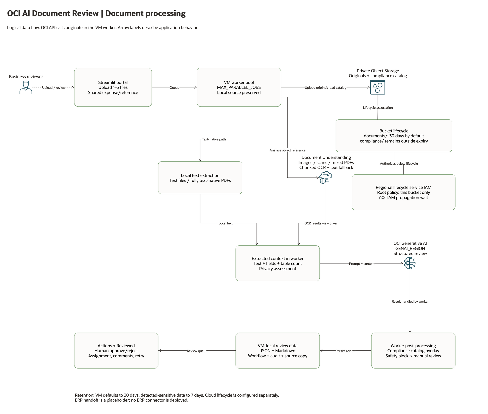
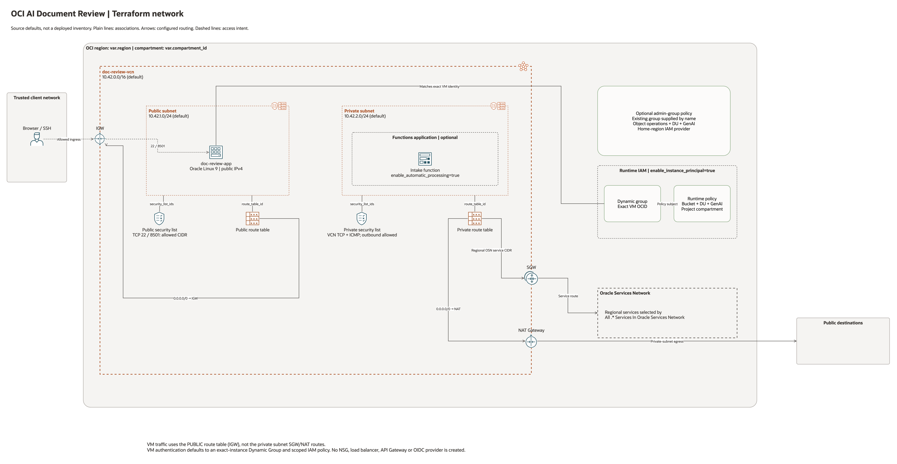
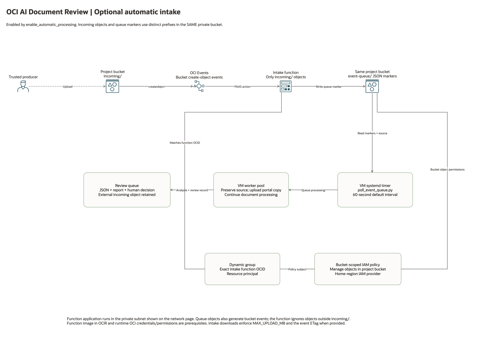
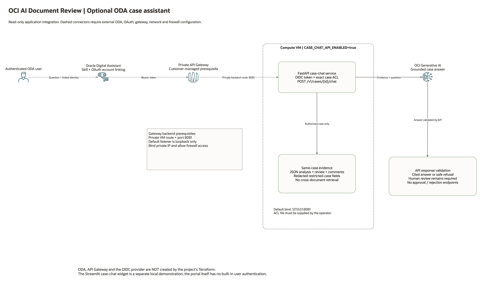

# Architecture and operational flows

Current project version: `v0.8.0`

The canonical architecture is the [editable four-page draw.io document](assets/oci-ai-document-review-architecture.drawio). It uses Oracle's OCI Architecture Diagram Toolkit v24.2. The PNGs below are rendered from those native pages; the earlier Excalidraw source remains available as historical material.

## Document processing



Reviewers submit one to five related files through Streamlit. A VM-local worker preserves the source, uploads the portal-managed original to the private project bucket, and performs extraction. Fully text-native inputs are extracted locally. Images, scanned PDFs and mixed text/image PDFs use Document Understanding; oversized PDFs are split into limit-safe chunks, and rich extraction has a text-only fallback.

The worker combines extracted text limited by `MAX_DOCUMENT_CHARS` with OCR fields and table counts, then sends the review prompt to OCI Generative AI. Instructions and structured fields add to the text limit. It handles content-safety blocks as manual-review cases, applies the curated compliance catalog, and stores local JSON metadata plus a Markdown report. The Actions and Reviewed pages support human decisions, assignment, comments, audit, retry and guarded discard. The ERP handoff remains a placeholder.

All service API calls originate in application code on the VM. Data-flow arrows do not imply that Object Storage directly invokes Generative AI, or that Document Understanding directly calls another model.

Local artifact retention defaults to 30 days, with a 7-day override for detected-sensitive records. Object Storage lifecycle is separate: it expires only `documents/`, and preserves the compliance catalog. The regional Object Storage service needs its own bucket-scoped IAM grant. Terraform creates that policy in the tenancy root by default and waits for propagation before installing the bucket lifecycle rule.

## Terraform network and identity



Source defaults are `10.42.0.0/16` for the VCN, `10.42.1.0/24` for the public subnet and `10.42.2.0/24` for the private subnet. Region and compartment are inputs. These defaults are not a statement about any customer's deployed inventory.

| Relationship | Source-defined behavior |
| --- | --- |
| Public subnet → public route table | Default IPv4 route to the Internet Gateway. |
| Public subnet → public security list | SSH 22 and Streamlit 8501 restricted to `allowed_ingress_cidr`. |
| Private subnet → private route table | Regional Oracle Services Network via the Service Gateway; default IPv4 route via NAT. |
| Private subnet → private security list | VCN TCP/ICMP ingress and outbound traffic. |
| VM → public subnet | Public IPv4; Oracle Linux 9 image filtered by configured shape. |
| Optional Functions application → private subnet | Created only with `enable_automatic_processing=true`. |
| VM → runtime Dynamic Group | Exact VM OCID, enabled by default. |
| Runtime Dynamic Group → IAM policy | Read project bucket; manage objects only in that bucket; use DU/GenAI only in the project compartment. |
| Regional Object Storage service → lifecycle | Root IAM policy restricted to the project bucket and inspect/read/delete permissions. |

The VM uses the public subnet's route table. The private subnet's Service Gateway/NAT routes are not the VM's path. No load balancer, NSG, API Gateway or OIDC provider is created by this Terraform.

The deployed VM defaults to instance-principal authentication, so the normal deployment does not copy a user OCI API key to the VM. Local development continues to use the operator's OCI profile. Legacy copied-key deployment is an explicit setup opt-in through `--vm-api-key-auth`; review that credential transfer before using it.

`resource_prefix` defaults to `doc-review`. Use a unique prefix, a unique bucket and separate Terraform state for an apply/test/destroy validation. `tenancy_id` and home-region IAM permissions are needed for the runtime Dynamic Group and lifecycle service policy. If lifecycle permission is already administered centrally, set `create_lifecycle_service_policy=false` or use setup's `--existing-lifecycle-service-policy`. `iam_propagation_wait_seconds` defaults to 60 and can be increased to 600 if IAM propagation is slower in the target region.

## Optional automatic intake



A trusted producer uploads into `incoming/`. The bucket emits create-object events; an Events rule invokes the intake Function, which writes JSON markers under `event-queue/` in the same private bucket. A VM systemd timer imports markers and submits the normal worker flow.

Incoming, queue and portal `documents/` prefixes must not overlap. This prevents recursive ingestion of the function's own markers or of portal-managed originals. Downloads are streamed, enforce `MAX_UPLOAD_MB`, and use the marker's ETag when present so overwritten content is not silently reviewed under an old event. An interrupted queue entry still in `UPLOADED` can be resubmitted when its marker is read again. Terminal records retain manual retry behavior.

The Function image in OCIR remains a prerequisite for this optional path. OCI's newer code-only Functions deployment is recorded in the [release review](component_release_review.md); it is not silently substituted for this image-based deployment.

## Optional ODA case assistant



The operator supplies ODA, OAuth account linking, an OIDC provider and a private API Gateway. The optional FastAPI service validates expiring, asymmetrically signed OIDC tokens and a default-deny document ACL. It retrieves only the selected case, redacts detected PII, and requests a cited answer from GenAI. Citation checking validates references, not the truth of a model's claims.

The listener defaults to loopback `127.0.0.1:8081`. Gateway access requires a private bind address, VM route and host-firewall rule supplied by the operator. The API has no approve/reject mutation endpoints. The separate in-portal chat widget is a local demonstration; the Streamlit portal itself does not provide end-user authentication.

## Worker coordination and retention

Metadata mutations use atomic replacement plus filesystem locking. A per-document lease protects active processing, retry and discard across the local portal and timer processes. Stale-job cleanup skips both submitted jobs and leased workers. A processor failure preserves the canonical source copy for retry. These are single-VM filesystem controls, not a distributed queue.

Deletion tombstones are retained separately. Incoming objects owned by external producers are not deleted by failed-document discard. Non-empty production buckets are not automatically emptied by the Terraform configuration.

## Editing, rendering and checking

Install the `oci-architecture-diagrams` skill with Oracle's toolkit and the draw.io desktop CLI. Regenerate the native document and render all pages sequentially:

```bash
.venv/bin/python scripts/build_architecture.py
.venv/bin/python scripts/render_architecture.py
```

Set `OCI_DIAGRAM_SKILL` or pass `--skill-dir` if the skill is installed elsewhere. Use `--drawio /path/to/drawio` for a nonstandard CLI location. The renderer exports temporary single-page files to avoid draw.io's version-dependent page numbering, then checks that each new PNG exists before replacing its published image.

[Connector/source coverage](architecture_connections.json) lists every connector's endpoints, meaning, style and source evidence. The builder checks all 23 declared Terraform resources, including optional resources and the IAM propagation wait. Native pages have unique IDs, valid source/target references and no layout-check warnings. All four published architecture pages have been converted; zero architecture pages remain in the old format as current deliverables.

The [banner and social preview](assets/oci-ai-document-review-banner.svg) are separately generated from the project version:

```bash
.venv/bin/python -m pip install -r requirements-docs.txt
.venv/bin/python scripts/build_banners.py
```

Static source and diagram checks do not prove cloud connectivity. Current execution evidence and limitations belong in [repository_review.md](repository_review.md), with historical acceptance records retained separately.

## Validation and publication status

The [London acceptance record](e2e_acceptance_notes.md#2026-11-05-live-london-validation) records the default deployment and its complete removal. Optional topology is source-reviewed and locally tested, not live acceptance evidence. Historical Excalidraw and dashboard assets remain dated reference material; the four-page draw.io source and its PNGs are canonical.

[Publication controls](security_notes.md#publication-controls) inspect source packages and the Git index before manual publication. Automatic GitHub workflows are disabled by removal, as requested by the maintainer.
